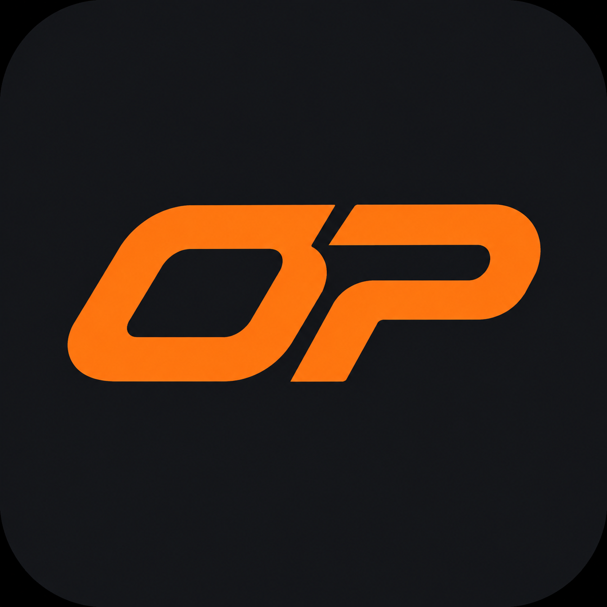

# OP CarPlay

适配搭载 **高通骁龙 820A 芯片**的老款小鹏 P7（Android 9），支持无线 CarPlay 和原车仪表导航。

**v0.7 · build 1350**

[下载 APK](https://github.com/heavendoorx7/OP-CarPlay/releases/latest) · [使用说明](docs/USAGE.md) · [构建指南](docs/BUILD.md) · [技术说明](docs/IMPLEMENTATION.md)

## 功能

| 功能 | 说明 |
| --- | --- |
| 无线 CarPlay | 通过车机原生热点连接 iPhone，支持触控、音频、麦克风和媒体控制 |
| 三种显示模式 | 原车分屏、保留系统栏的全屏、隐藏状态栏与 Dock 的完全全屏 |
| 中文设置 | 左侧分类、右侧设置，支持默认显示模式和设备名称等配置 |
| 手势入口 | 五指向内收拢或三指下滑呼出设置 |
| 自动开启热点 | 可选开启，复用原车热点名称、密码和频段配置 |
| 应用内授权 | 支持通过已开启的本机 ADB 或已运行的 Shizuku 授权 |
| 仪表导航 | 在原车导航卡片内显示 iPhone 独立地图，退出后恢复原车地图 |
| 车道条隐藏 | OP 投放时可隐藏原车蓝色车道条，退出后交回原车显示 |

**仪表盘导航目前仅测试了高德地图，其他地图应用尚未验证。**

## 开始使用

1. 从 Releases 下载 APK，通过车机已有的安装入口安装。
2. 打开车机原生热点，在 OP 中填写热点名称、密码和安全类型。
3. 配置认证方式。发行 APK 不内置认证证书或私钥，需要自行提供。
4. 将 iPhone 与车机蓝牙配对，保存设置并连接。

使用仪表导航前，请在设置中启动仪表通道，并让原车仪表显示导航卡片。操作步骤见 [使用说明](docs/USAGE.md)。

## 适配范围

- 面向搭载骁龙 820A、运行 Android 9、中控分辨率为 2400×1200 的老款小鹏 P7；其他车型与系统未验证。
- 仪表地图内容由高德决定，缩放、3D 和车道级效果可能与中控不同。
- 显示尺寸切换可能触发重连；老 P7 有线 CarPlay 尚未完成实车验证。
- 自动热点需要相应授权，重启与休眠唤醒效果取决于车机固件。原车配置为 5 GHz 时复用该频段。

## 开发与许可

基于 [xcertplay](https://github.com/shilapi/xcertplay) 开发，采用 [GPL-3.0](LICENSE) 许可。构建方式见 [BUILD](docs/BUILD.md)，来源与依赖见 [NOTICE](NOTICE.md)，安全问题见 [SECURITY](SECURITY.md)。

本项目为社区适配，与小鹏、Apple 无隶属关系。
